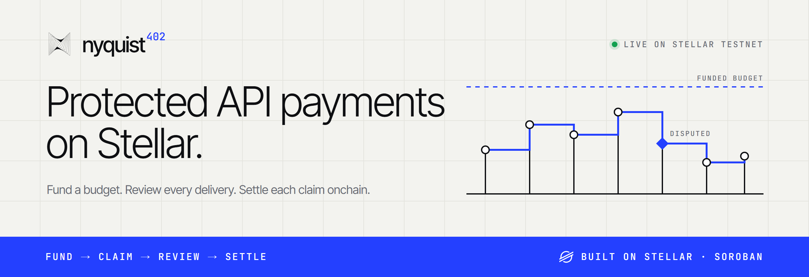
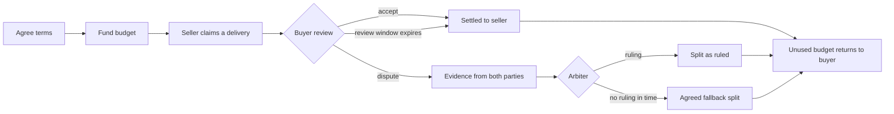

<picture>
  <source media="(prefers-color-scheme: dark)" srcset=".github/assets/banner-dark.png">
  
</picture>

<p align="center">
  <a href="https://nyquist402.xyz">Website</a> ·
  <a href="https://docs.nyquist402.xyz">Docs</a> ·
  <a href="https://nyquist402.xyz/demo">Testnet demo</a> ·
  <a href="https://nyquist402.xyz/stats">Onchain stats</a> ·
  <a href="https://status.nyquist402.xyz">Status</a>
</p>

<p align="center">
  <a href="https://stellar.org"></a>
  <a href="https://developers.stellar.org/docs/build/smart-contracts/overview"></a>
  <a href="https://stellar.expert/explorer/testnet/contract/CBX657PJAHLHBNVZASBJPRJFKWKYAGFCKMEE5A57I3ZNPWO5RPKPOMEH"></a>
  <a href="https://www.x402.org"></a>
  <a href="LICENSE"></a>
</p>

# Nyquist402

Nyquist402 lets buyers and software agents fund work before its final cost is known. The buyer and seller agree a budget and settlement rules. The seller records delivery claims, and the buyer reviews each claim before it is paid. Soroban escrow enforces the agreement, and arbitration resolves disputed deliveries.

An x402 `exact` payment needs the price up front. Metered APIs, agent tasks and long-running jobs only know their cost after they run. Nyquist402 makes that budget safe to fund: money moves only for accepted or ruled deliveries, and anything unused returns to the buyer.

## How a protected payment works



1. **Agree the work.** Define delivery criteria, pricing, budget, deadlines, arbiters and the fallback if arbitration times out.
2. **Fund the agreement.** The buyer funds the work budget and any accepted protocol and arbitration reserves. Both parties authorize the exact terms.
3. **Record delivery.** The seller submits a claim for completed work. Each claim reserves its own part of the budget and starts a review window.
4. **Review or dispute.** The buyer accepts the claim, or either party opens a dispute before review closes. An undisputed claim becomes eligible for settlement after review.
5. **Settle and recover unused funds.** Acceptance, review expiry, a valid ruling or the agreed fallback finalizes each claim. Unused funds return without spending another claim's reservation.

The contract controls fund allocation. Principal, protocol-fee reserves and arbitration reserves are tracked separately. An arbiter can allocate only the disputed claim's principal and earn only its accepted fee. Nyquist402 services provide transaction execution, private evidence delivery and payment history; they cannot change a funded agreement or finalize a claim twice.

## Live on Stellar testnet

| | |
| --- | --- |
| Protected escrow | [`CBX657PJAHLHBNVZASBJPRJFKWKYAGFCKMEE5A57I3ZNPWO5RPKPOMEH`](https://stellar.expert/explorer/testnet/contract/CBX657PJAHLHBNVZASBJPRJFKWKYAGFCKMEE5A57I3ZNPWO5RPKPOMEH) |
| Token | Circle testnet USDC, issuer `GBBD47IF6LWK7P7MDEVSCWR7DPUWV3NY3DTQEVFL4NAT4AQH3ZLLFLA5`, seven decimals |
| Continuous testing | Every 15 minutes a new testnet wallet funds and settles one of nine scenarios through the public API: accept, multiple claims, review expiry, default arbiter ruling, buyer-chosen arbiters, seller dispute, signed fallback and reclaim after the deadline |
| Monitoring | [status.nyquist402.xyz](https://status.nyquist402.xyz) checks the site, API, sign-in, contract, RPC and Horizon every 5 minutes |
| Onchain history | [nyquist402.xyz/stats](https://nyquist402.xyz/stats) reports payments, settled amounts, outcomes and every contract event |

To try it yourself, open the [demo](https://nyquist402.xyz/demo). It has Buyer, Seller and Arbiter views for one payment. Connect a Stellar testnet wallet with test XLM, add the USDC trustline and get USDC from [Circle's faucet](https://faucet.circle.com/) on **Stellar Testnet**.

## Documentation

| You want to… | Start here |
| --- | --- |
| Try the flow end to end | [Demo walkthrough](https://docs.nyquist402.xyz/quickstart) |
| Pay for work as a buyer or agent | [Buyer workflow](https://docs.nyquist402.xyz/protected/buyer) |
| Accept protected payments for your API | [Seller workflow](https://docs.nyquist402.xyz/protected/seller) and [SDK integration](https://docs.nyquist402.xyz/sdk) |
| Connect it to x402 negotiation | [Payment negotiation](https://docs.nyquist402.xyz/integration) |
| Handle arbitration cases | [Arbiter workflow](https://docs.nyquist402.xyz/protected/arbiter) |
| Understand budgets, fees and settlement | [Payment lifecycle](https://docs.nyquist402.xyz/protected/lifecycle) and [fee reserves](https://docs.nyquist402.xyz/protected/fees) |
| Retrieve evidence or recover a payment | [Evidence access](https://docs.nyquist402.xyz/services/evidence) and [history and recovery](https://docs.nyquist402.xyz/protected/recovery) |
| Review trust boundaries | [Architecture](https://docs.nyquist402.xyz/architecture) and [security model](https://docs.nyquist402.xyz/reference/security) |

Payments that only need a spending ceiling and capture of the actual cost can use [basic auth-capture](https://docs.nyquist402.xyz/basic), a separate flow without claim review.

## Repository

| Path | Contents |
| --- | --- |
| [`contracts/protected-escrow-v2`](contracts/protected-escrow-v2) | Current protected escrow: claims, reviews, disputes, rulings, fallback, fee reserves |
| [`contracts/auth-capture-escrow`](contracts/auth-capture-escrow) | Basic auth-capture escrow: authorize, capture, void, refund, reclaim |
| [`contracts/protected-escrow`](contracts/protected-escrow) | Earlier protected escrow, kept for existing testnet payments |
| [`web/lib/protected`](web/lib/protected) | TypeScript client: terms encoding, payment IDs, authorization checks, transactions ([guide](web/lib/protected/README.md)) |
| [`web/server`](web/server) | Payment API: quotes, delegated seller signing, sign-in, evidence, history |
| [`web/convex`](web/convex) | Hosted backend: service store, event index, scheduled scenario runs and status checks |
| [`web/app`](web/app), [`web/content/docs`](web/content/docs) | Website, demo, stats and status pages, and documentation |

## Development

Use Node 24 and pnpm:

```sh
cd web
pnpm install --frozen-lockfile
pnpm dev
```

Configure testnet service credentials in `web/.env`; `web/.env.local` is an optional override. Set `DEMO_MERCHANT_SECRET`, a stable `DEMO_SESSION_SECRET` of at least 32 characters and `DEMO_ARBITER_SECRETS` for the operated arbitration accounts. Restart after configuration changes. Development and production startup both load these files; externally supplied environment variables take precedence.

Preserve existing funded keys and keep secrets out of Git. For a new environment, `pnpm setup-demo` creates testnet accounts and USDC trustlines. It refuses to recreate credentials when either configuration file already exists. `node scripts/setup-usdc.mjs` inspects recipient trustlines; its `--apply` mode adds missing ones. The demo uses official USDC rather than minting a token.

Local runs keep private service data in `web/.nyquist-data` (or `DEMO_DATA_DIR`), which stays out of Git. Wallet sign-in controls private history and evidence access; transaction signatures separately control fund movements.

`npx tsx scripts/e2e-matrix.ts [payments] [buyers]` runs the scenario matrix against the local API on testnet. It spends test funds, so run it only for intended test payments.

## Hosting

The site runs on Vercel. `scripts/vercel-build.mjs` bundles the API into one Node function next to the static client. `nyquist402.xyz` serves the site, and `docs.` and `status.` serve those pages at their roots ([`web/lib/site.ts`](web/lib/site.ts)).

Hosted instances keep service data in Convex instead of SQLite. Set `CONVEX_URL`, `CONVEX_STORE_KEY` and `VITE_CONVEX_URL` on Vercel, then set the same `CONVEX_STORE_KEY` and `SITE_URL` on the Convex deployment. Deploy the Convex functions with `npx convex deploy` from `web`; Git pushes deploy only the Vercel side.

Convex runs three crons:

- Every 5 minutes it copies new escrow contract events into its own tables, so the totals outlive RPC's seven-day retention.
- Every 5 minutes it checks each component from outside the site for the status page.
- Every 15 minutes it runs one payment scenario against the hosted API with a new testnet wallet.

## Verify

```sh
cargo test --workspace --locked
cargo fmt --all -- --check
cargo clippy --workspace --all-targets --locked -- -D warnings
stellar contract build
cd web
pnpm test
pnpm typecheck
pnpm build
```

## Project status

The protected escrow, demo, payment API and SDK client run on Stellar testnet. Protected x402 negotiation, SDK package distribution, the public facilitator API, managed service guarantees and automatic storage recovery are **not fully implemented yet**. The [service roadmap](https://docs.nyquist402.xyz/roadmap) explains how they will work. The contracts are unaudited, and mainnet service is not available yet.

## License

[MIT](LICENSE)
